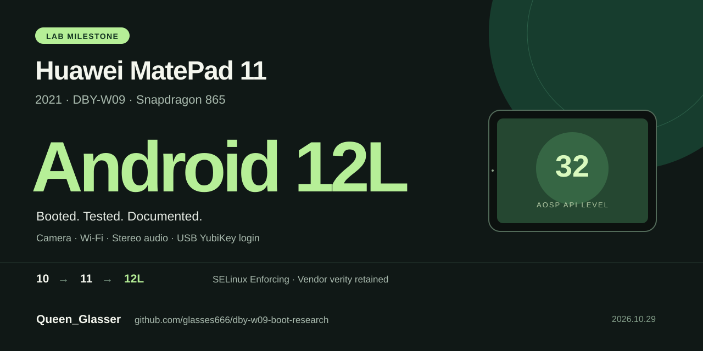

# Huawei MatePad 11 → Android 12L



**Android 10 → 11 → 12L on the Huawei MatePad 11 (2021, DBY-W09, Snapdragon 865).**
Original compatibility research, offline builders and evidence by
**Queen_Glasser ([glasses666](https://github.com/glasses666))**.

华为 MatePad 11 已运行 Android 12L / API32。显示、触控、相机、Wi-Fi、扬声器、
Google 服务和 USB YubiKey 登录均有实机证据。这里保存从启动故障到可用系统的研究与最小修复。

[Latest release](https://github.com/glasses666/dby-w09-boot-research/releases/latest) ·
[Build & recovery](docs/BUILD_AND_RECOVERY.md) · [Hardware status](docs/API32_DAILY_BRINGUP.md) ·
[Cite this work](CITATION.cff) · [Research history](docs/PROVENANCE.md)

| Surface | Verified on the research device |
|---|---|
| Android | 12L / API32; boot complete, Launcher3 and Settings; repeated cold boots |
| Security / root | SELinux Enforcing, vendor verity and existing APatch root retained |
| Display / touch / GPU | 1600×2560, 60/120 Hz; Adreno EGL/Vulkan |
| Connectivity | Validated Wi-Fi and Bluetooth discovery; pairing untested |
| Camera / sensors | Preview, decoded 4000×3000 JPEG and live sensor events |
| Audio | Audible mono/stereo, persistent speaker repair and nonzero microphone samples |
| Google services | Systemless GSF/GMS/Play Store; real account addition |
| Hardware passkeys | Chrome → GMS → USB YubiKey → CTAP2 assertion → successful ChatGPT login |
| GNSS | HAL/provider registration; satellite fix untested |

USB-free suspend/resume, torch, pairing, long-duration stability and Play/streaming certification
remain open. [The detailed matrix](docs/API32_DAILY_BRINGUP.md) separates each acceptance level.

## Research milestones

This repository is a sanitized, source-only research snapshot for an
owner-operated Huawei MatePad 11 DBY-W09. It records six connected results:

1. staged probes narrowed the original LineageOS 21 failure from the general
   boot chain through the original init entry shim and into `main`;
2. a context-closed Android 10/API29 baseline then reached a stable AOSP
   Launcher after one exact 34-byte init-language repair;
3. an Android 11/API30 system then reached a completed core-system boot after
   a five-byte init compatibility patch for Huawei's legacy `/data/nfc` mkdir;
4. an exact-target VINTF replay reduced the Android 12/API32 compatibility
   change to one framework GNSS 1.1 declaration, and that system reached a
   boot-complete Launcher with the original boot and vendor chain retained;
5. reversible API32 bring-up then validated most hardware surfaces, localized
   and persistently repaired speaker playback, and added optional systemless
   Google services and a local two-path VPN without another partition write;
6. a single GMS runtime permission restored Chrome's FIDO2 UI, USB YubiKey
   assertion and user-confirmed ChatGPT login. See [the passkey report](docs/API32_PASSKEY_AND_TERMUX.md).

截至 2026-10-29，当前保留在设备上的系统为 Android 12/API32。PID 1 为
`/system/bin/init second_stage`，两个 boot-complete 属性均已建立，bootanimation
停止，Launcher3 和设置界面可见。`vendor-verity`、SELinux Enforcing 和既有 root
能力保留；keystore2、system_suspend、SurfaceFlinger 与 system_server 稳定，GNSS
1.0/1.1/2.0 实例和启用的 GPS provider 可见。显示、触摸、GPU、传感器、加密存储、
Wi-Fi、蓝牙扫描、相机、DRM 能力和非零麦克风采样已通过有界实测；扬声器根因收敛到
缺失的 vendor-enhanced 状态，四字节候选与无分区写入的持久覆盖已通过冷启动机器门禁。
最小 Google Play 栈已完成真实账号添加；FlClash 本地配置的两条私有出口均通过 HTTPS
实测。所有账号、节点凭据与私有基础设施信息继续排除在公开树之外。

这不是“全硬件适配完成”。实际卫星定位、USB 断开后的休眠唤醒、后置闪光灯、
蓝牙配对、长期稳定性和真实商店下载仍需分别验证。当前结果是
可回滚研究基线，不是通用刷机包或完整日用 ROM 声明。API30 的 NFC 兼容修复仍作为
通向 API32 的独立、可复核历史里程碑保留。

## Included

- `scripts/`: offline image builders, exact-target VINTF replay, streamed
  readback comparison and staged witness sources;
- `tests/`: synthetic tests plus explicit private-fixture skips;
- `docs/`: the current boundary, methodology, API29 baseline, API30 repair and
  accepted API32/GNSS 1.1 and post-boot bring-up results;
- `evidence/public-findings.json`: sanitized, machine-readable findings;
- `SOURCE_MAP.md`: private-to-public mapping and exclusions;
- `tools/validate_public_tree.py`: redaction, link and manifest checks.

The [release downloads](https://github.com/glasses666/dby-w09-boot-research/releases/latest)
package this reviewed source and the speaker-module builder with SHA-256 checksums.
The archives are research kits; they are not recovery-flashable ROM ZIPs.
The tested complete `super` contains Huawei vendor/ODM firmware, and the rooted `boot`
is installation-specific. Follow [build and recovery](docs/BUILD_AND_RECOVERY.md) for
local input requirements and current reconstruction limits.

The repository does **not** contain vendor firmware, partition images,
Firehose programmers, device or USB identifiers, raw device logs, screenshots,
personal backups, proprietary disassembly projects, live-write automation or a
one-click flashing workflow.

## Verify this snapshot

```bash
PATH=/usr/bin:/bin:/usr/sbin:/sbin \
  python3 -B -m unittest discover -s tests -p 'test_*.py' -v
python3 -B tools/validate_public_tree.py --check
```

The test suite uses only Python's standard library. Some AArch64 compilation
tests use `/usr/bin/clang` on macOS. Optional proprietary inputs are never
downloaded; when absent, their tests skip explicitly. See
[`private-fixtures/README.md`](private-fixtures/README.md).

## Reading order

1. [`docs/API32_GNSS_1_1_SUCCESS.md`](docs/API32_GNSS_1_1_SUCCESS.md)
2. [`docs/API32_DAILY_BRINGUP.md`](docs/API32_DAILY_BRINGUP.md)
3. [`docs/API30_NFC_COMPATIBILITY.md`](docs/API30_NFC_COMPATIBILITY.md)
4. [`docs/API29_USABLE_BOOT.md`](docs/API29_USABLE_BOOT.md)
5. [`docs/RESEARCH_STATUS.md`](docs/RESEARCH_STATUS.md)
6. [`docs/BOOT_BOUNDARY.md`](docs/BOOT_BOUNDARY.md)
7. [`docs/METHODOLOGY.md`](docs/METHODOLOGY.md)
8. [`docs/SAFETY_AND_SCOPE.md`](docs/SAFETY_AND_SCOPE.md)

## Publication

Public repository: <https://github.com/glasses666/dby-w09-boot-research>

Public attribution: **Queen_Glasser (@glasses666)**. No license has been
granted; unless and until a license is added, all rights are reserved. No
firmware or prebuilt flashable artifact is released from this repository.

Use [CITATION.cff](CITATION.cff), retain the author and original URL, and identify the
release/commit when discussing these findings. [Provenance](docs/PROVENANCE.md) links the
published milestones. REA, Ghidra and Codex assisted the investigation; upstream and
tool credits are in [AUTHORS.md](AUTHORS.md). No global first-discovery claim is made.
See [COPYRIGHT.md](COPYRIGHT.md) for the existing rights reservation and
[CONTRIBUTING.md](CONTRIBUTING.md) for submitting reproducible findings.
