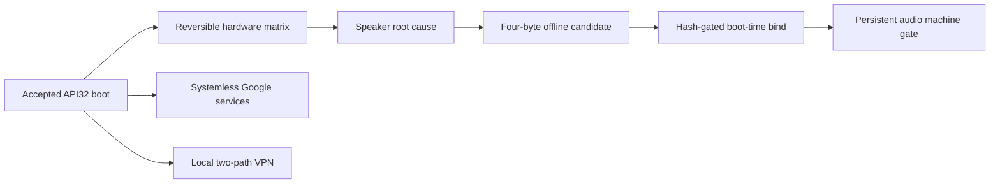

# Android 12/API32 post-boot bring-up

## Result

The retained API32 system has advanced from a boot-complete research baseline
to a substantially usable tablet. Reversible tests now cover display, touch,
GPU, sensors, encrypted storage, Wi-Fi, Bluetooth discovery, camera capture,
DRM capability, microphone input and speaker playback. Repeated cold boots also
retained the accepted system, root path and systemless compatibility layers.

This is not a claim of complete hardware support or production security. An
actual satellite fix, unplugged suspend/resume, rear torch, Bluetooth pairing,
long-duration stability and any system newer than API32 remain open.

## Evidence to finding

| Evidence | Supported finding | Limit |
|---|---|---|
| Bounded 13-section hardware snapshot plus reversible app tests | Display/touch/GPU, sensors, storage, validated Wi-Fi, Bluetooth discovery, Widevine L1 instantiation, camera preview/JPEG and nonzero microphone capture work on API32 | Bluetooth pairing, licensed DRM playback and controlled acoustic microphone quality were not tested |
| Audio HAL, device-tree and smart-amplifier evidence | Four responding amplifiers are NXP TFA9874 devices; the initial Awinic interpretation was false | Hardware identity alone did not repair playback |
| Four-byte detector candidate and repeated mono/stereo trials | Missing vendor-enhanced state selected an absent Cirrus path; returning the stock ODM-only value selected generic speaker protection and restored audible output | The vendor library itself is proprietary and is not distributed |
| Hash-gated boot-time single-file bind | The accepted speaker candidate survives cold boot without a partition write; the live hash, mount, HAL branch and stereo frame sequence passed machine gates | A separate human confirmation of the post-persistence left/right sequence was not recorded; earlier transient left/right trials were accepted |
| Minimal systemless Google service set | GSF, Google Play services and Play Store register as privileged system packages; real account addition completed while root, Enforcing and the speaker layer remained active | App download, Play Protect certification and Play Integrity were not claimed |
| Local Android VPN profile with two private egress paths | Both direct-VPS and VPS-to-authenticated-proxy paths returned HTTPS 204 with distinct public egress identities | Server addresses, credentials and the profile remain private |
| Chrome/GMS FIDO2 and USB security key | A single GMS runtime permission restored the authentication UI and a fresh CTAP2 assertion; the owner confirmed ChatGPT login | Applies to this API32/GMS combination; see [the sanitized diagnosis](API32_PASSKEY_AND_TERMUX.md) |

## Hardware matrix

| Surface | Current result |
|---|---|
| Display, touch and GPU | Pass: 1600×2560, 60/120 Hz, QTI HWC and Adreno EGL/Vulkan active |
| Sensors | Pass: motion, magnetic, light, orientation and fused sensors enumerate; live motion events observed |
| Storage | Pass: encrypted writable F2FS `/data`, writable ext4 `/metadata` and scoped storage |
| Wi-Fi | Pass: saved network, DHCP/default route and framework `VALIDATED` Internet |
| Bluetooth | Discovery pass: adapter stayed enabled and a complete scan found nearby devices; no pairing |
| Camera | Pass: two physical IDs, live preview and a host-decoded 4000×3000 JPEG |
| DRM | Capability pass: Widevine CDM 15.0.0 instantiated at L1 and ClearKey 1.2 instantiated |
| Microphone | Partial positive: 288,000 nonzero AudioRecord bytes; no controlled acoustic source |
| Speaker | Persistent machine pass; audible mono and stereo accepted before persistence |
| GNSS | Stack pass only: framework/provider registration works; no satellite fix yet |
| Power | Partial: display sleep and system_suspend work, but USB-connected kernel suspend did not increment |
| Reboot persistence | Pass for the retained API32 system, root path, speaker layer and later systemless services |
| Browser hardware passkeys | Pass: Chrome/GMS, USB YubiKey assertion and user-confirmed ChatGPT login |

## Speaker root cause and reproducible patch

Stock vendor configuration contributes the ODM-only bit to
`getVendorEnhancedInfo`. The GSI runtime's separate `/odm` lacks the nested
property source, and the Audio HAL sees value zero. That selects the Cirrus
speaker-protection library even though this device exposes four NXP TFA9874
amplifiers and no Cirrus playback node. PCM prepare then fails before audible
output.

[`build_api32_vendor_enhanced_detector_overlay.py`](../scripts/build_api32_vendor_enhanced_detector_overlay.py)
accepts only the exact 14,976-byte ELF32 source with SHA-256
`1927811cdf681ab289ae32b73c6e59f94e63b505a7763a445db2942f5e179156`.
It replaces four bytes at file offset `0x102c`:

```text
10 b5 0a 48  ->  01 20 70 47
```

The replacement is ARM32 Thumb `movs r0, #1; bx lr`, the stock ODM-only
semantic. The accepted output SHA-256 is
`706c5d92e7d6416b9ed194ede6e65e61259565a8d1ffa0dfada3cd096d72560c`.
The builder rejects a wrong source hash, ELF identity or function prefix and
requires every other byte to remain equal.

The private device uses a hash-gated root-managed bind mount before Audio HAL
startup. This public repository does not distribute the vendor input/output,
the module package, root secret, installer or live-write automation.

## Optional userland layers

Google services were added with four API32/ARM64 LiteGapps components. APatch
accepted the modules on the first attempt but mounted none of their `system/`
payloads because no MetaModule was installed. Adding one reviewed mount
provider made the same hash-verified payload visible read-only under
`/system/product` and `/system/system_ext`. Two normal boots completed in about
28 seconds, and account addition changed only a redacted account count from
zero to one. No account identifier, password, token, authentication log or
credential screenshot was retained.

The VPN qualification found a second useful rule. A host-side request to a
candidate server appeared reachable only because the host's active proxy
captured it. Binding the test core to the physical uplink exposed the false
positive. The final local Android profile uses a genuinely reachable endpoint
and keeps both private chains selectable. Neither the profile nor a generic
node builder is published because both would expose personal infrastructure.



## Remaining boundary

1. Obtain a fresh outdoor satellite fix rather than relying on service
   registration.
2. Test suspend and wake with USB physically absent and a separate return path.
3. Exercise rear torch and Bluetooth pairing as separate reversible tests.
4. Run a longer stability window and real Play Store application download.
5. Treat Android 13 or newer as a new compatibility experiment, not an
   incremental update assumed to inherit API32 success.
