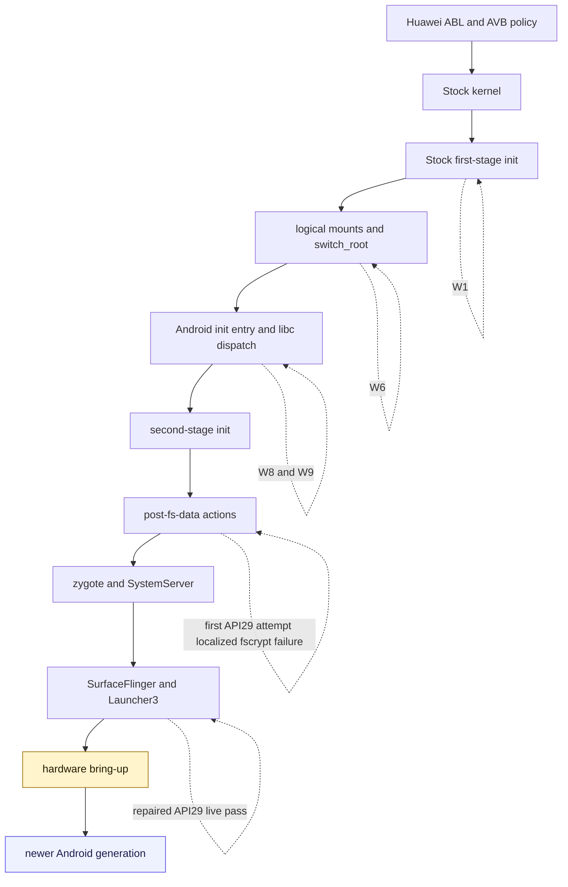

# Boot boundary

The investigation first used single-question probes to locate the failing
Lineage path, then pivoted to a context-closed API29/VNDK29 system that matched
the vendor generation closely enough to reach a usable desktop.

The original Lineage path remains a valuable control-flow result, but the
strongest live boundary is now later: Android framework and a usable launcher
executed on the repaired API29 baseline. Camera compatibility and the other
untested hardware surfaces are outside that proof.

The successful attempt remained bound to a fixed candidate hash, complete
pre-reset partition readback, fresh transport enumeration and one declared
normal reset. Familiar UI alone was not accepted as proof: the record also
required second-stage PID 1, fresh boot identity, boot-complete properties,
service state and foreground-activity evidence.
